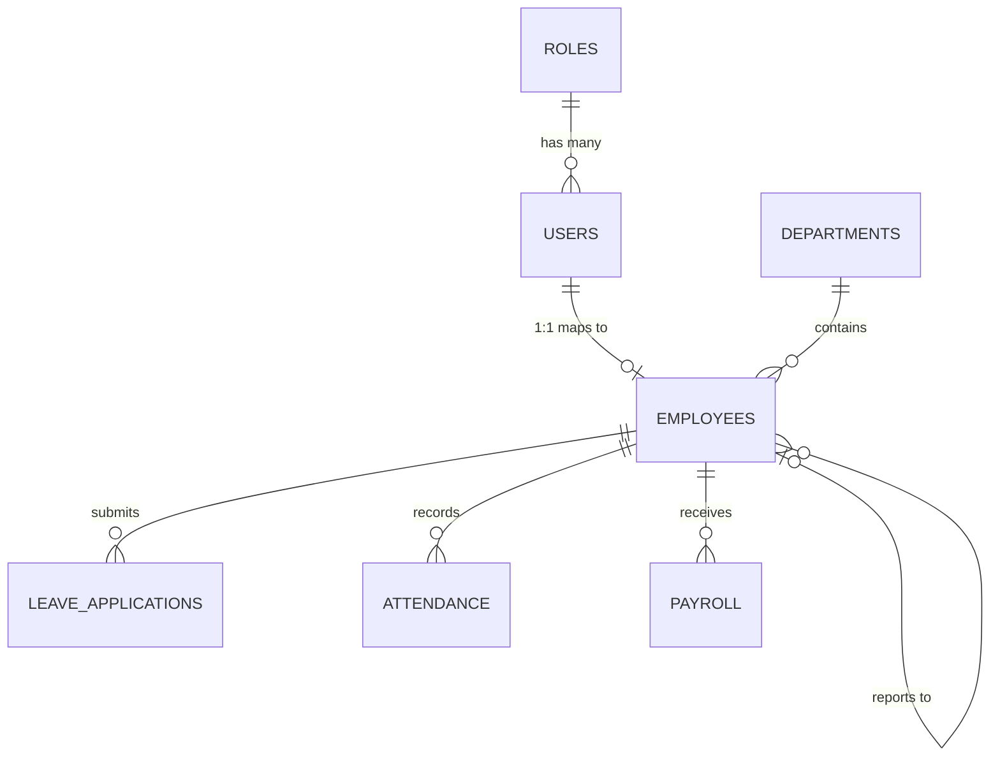

# Product Requirements Document (PRD): CBDP HR Management System

## 1. Executive Summary
**CBDP HR** is a modern, scalable, and original Human Resource Management System (HRMS) designed to streamline employee lifecycle management, attendance, leave, payroll, and organizational workflows. Built on a robust JavaScript stack (MERN + Tailwind CSS), CBDP HR offers a unified, secure, and user-centric platform for HR administrators, managers, and employees to collaborate efficiently. This PRD serves as the authoritative specification for designing, developing, testing, and deploying CBDP HR.

---

## 2. Product Vision and Objectives
**Vision:** To provide a frictionless, automated, and insightful HR experience that empowers organizations to focus on people rather than paperwork.
**Mission:** Deliver a highly responsive, aesthetically premium, and functionally complete web-based HRMS with self-service capabilities and intelligent approval workflows.
**Problem Statement:** Organizations struggle with fragmented HR processes, manual leave and payroll calculations, and lack of real-time insights into workforce metrics.
**Target Audience:** Mid-sized enterprises (50-500 employees) seeking a consolidated HR solution.
**Business Objectives:**
- Reduce administrative overhead by 40% within the first year.
- Achieve 99.9% uptime and high user adoption.
- Ensure data security and strict role-based access control.

---

## 3. Scope and Assumptions
**In Scope:**
- Core HR operations (Employee, Dept, Roles, Leave, Attendance, Payroll).
- Multi-tier approval workflows.
- Analytics dashboard.
- Role-based Access Control (RBAC).

**Out of Scope (Phase 1):**
- Candidate recruitment and Applicant Tracking System (ATS).
- Third-party ERP integrations.
- Native mobile applications (iOS/Android).

**Assumptions:**
- Employees have access to modern web browsers.
- Standard workweek and leave policies can be templated.

---

## 4. User Personas and Permissions Matrix

### Personas
- **Super Admin:** Complete system configuration and IT management.
- **HR Administrator:** Manages all HR operations, payroll, and master data.
- **HR Manager:** Oversees daily HR processes, approvals, and reporting.
- **Department Manager:** Manages department employees, schedules, and first-level approvals.
- **Finance/Payroll Officer:** Handles payroll processing, expenses, and reimbursements.
- **Employee:** Self-service portal for leave, attendance, and payslips.

### Permissions Matrix
| Feature / Role | Super Admin | HR Admin | HR Manager | Dept Manager | Finance | Employee |
|---|---|---|---|---|---|---|
| **Users & Roles** | CRUD | R | - | - | - | - |
| **Employee Data** | CRUD | CRUD | CRU | R (Own Dept) | R | R (Self) |
| **Leave Approval** | - | Override | Approve (L2) | Approve (L1) | - | Request |
| **Payroll Config** | CRU | CRU | R | - | CRU | - |
| **Expenses** | - | R | R | Approve (L1) | Approve (L2)/Pay | Request |
| **System Settings** | CRUD | RU | R | - | - | - |

*(C = Create, R = Read, U = Update, D = Delete)*

---

## 5. Complete Sitemap

- **Authentication & Account**
  - `/login` - User Login
  - `/forgot-password` - Password Reset
  - `/reset-password`
- **Dashboard & Analytics**
  - `/dashboard` - Role-based overview
- **Organization**
  - `/org/departments`
  - `/org/locations`
  - `/org/structure`
- **Employee Management**
  - `/employees` - Directory
  - `/employees/new` - Onboarding
  - `/employees/:id` - Profile
- **Time & Attendance**
  - `/attendance` - Daily Logs
  - `/attendance/wfh` - Remote Work
  - `/attendance/shifts` - Schedules
- **Leave Management**
  - `/leave/apply`
  - `/leave/balances`
- **Approval Center**
  - `/approvals/pending`
  - `/approvals/history`
- **Payroll & Finance**
  - `/payroll/salary-structures`
  - `/payroll/generate`
  - `/payroll/expenses`
- **Assets & Documents**
  - `/assets` - Device Management
  - `/documents` - Policy/Compliance
- **System Settings**
  - `/settings/roles`
  - `/settings/workflows`
- **Error States:** `/404` (Not Found), `/403` (Access Denied)

---

## 6. Functional Requirements

| Req ID | Module | Description | Validation/Rules |
|---|---|---|---|
| **FR-EMP-001** | Employee | HR Admin can add a new employee. | Required: Name, Email (unique), Dept, Role, Joining Date. |
| **FR-ATT-001** | Attendance | System records daily clock-in/out. | Cannot clock-out before clocking in. Geo-tagging optional. |
| **FR-LEV-001** | Leave | Employee can submit leave requests. | Date range must be future or current. Must have sufficient balance. |
| **FR-APR-001** | Approvals | Dept Manager can approve/reject leave. | Must provide reason for rejection. |
| **FR-PAY-001** | Payroll | Finance can generate monthly payroll. | Calculates base + bonus - deductions (leaves/advances). |
| **FR-DSH-001** | Dashboard| Display live headcount and absences. | Refreshes data dynamically on load. Cache for 5 mins. |

---

## 7. User Stories and Acceptance Criteria

**Story 1: Leave Application**
*As an Employee, I want to apply for sick leave so that my manager is notified and my balance is updated.*
- **ID:** US-01 | **Priority:** P0
- **Criteria:** 
  - Given I am on the Leave Apply page.
  - When I select "Sick Leave" and dates, and click Submit.
  - Then a pending request is created, an email is sent to my Dept Manager, and my provisional balance is reduced.

**Story 2: Payroll Generation**
*As a Finance Officer, I want to generate the monthly payroll so that employees get paid.*
- **ID:** US-02 | **Priority:** P0
- **Criteria:**
  - Given the month has ended.
  - When I click "Run Payroll" for a department.
  - Then the system calculates LWP (Leave Without Pay), generates payslips, and sets status to "Pending Disbursement".

---

## 8. UI/UX Specifications
**Design System:**
- **Branding:** CBDP HR (Minimalist, Corporate, Trustworthy).
- **Colors:** 
  - Primary: Indigo (`#4f46e5`)
  - Secondary: Slate (`#64748b`)
  - Success: Emerald (`#10b981`), Danger: Rose (`#f43f5e`), Warning: Amber (`#f59e0b`)
- **Typography:** Inter (Sans-serif) for headings and body.
- **Components:** 
  - Sidebar: Fixed left, collapsible, dark mode (`bg-slate-900`).
  - Topbar: Breadcrumbs, Global Search, Notification Bell, User Avatar.
  - Tables: React Table with pagination, sorting headers, row hover states (`hover:bg-slate-50`).
- **States:** Skeleton loaders for data fetching, Toast notifications for actions, Empty state illustrations for zero-data tables.

---

## 9. Wireframes (Text-based)
**Dashboard Layout:**
```text
[ Sidebar (Dark) ] [ Top Navigation: Search | Notifications | Profile (Light) ]
[ Logo         ] | --------------------------------------------------------
[ Dashboard    ] | [ Welcome back, {Name}! ]
[ Employees    ] |
[ Attendance   ] | [ Headcount: 120 ] [ On Leave: 5 ] [ Pending Approvals: 3 ]
[ Leave        ] |
[ Payroll      ] | [ Chart: Dept Distribution ]  [ List: Recent Activity ]
[ Approvals    ] | 
[ Settings     ] | 
```

---

## 10. MongoDB Collections and Data Models

### 10.1 Technology Choice
- **MongoDB:** Flexible schema design, ideal for hierarchical org structures and dynamic payroll structures.
- **Mongoose:** Enforces schema validation, handles relationships via `ObjectId`.

### 10.2 Collections
**1. Users Collection**
```json
{
  "_id": "ObjectId",
  "email": "String (Unique, Indexed)",
  "passwordHash": "String",
  "roleId": "ObjectId (Ref: Roles)",
  "employeeId": "ObjectId (Ref: Employees)",
  "isActive": "Boolean",
  "createdAt": "Date"
}
```

**2. Employees Collection**
```json
{
  "_id": "ObjectId",
  "firstName": "String",
  "lastName": "String",
  "departmentId": "ObjectId (Ref: Departments)",
  "managerId": "ObjectId (Ref: Employees)",
  "joiningDate": "Date",
  "employmentStatus": "String (Enum: Active, Terminated, Probation)",
  "salaryStructure": { "base": "Number", "currency": "String" }
}
```

**3. Leave Applications Collection**
```json
{
  "_id": "ObjectId",
  "employeeId": "ObjectId (Ref: Employees)",
  "leaveType": "String",
  "startDate": "Date",
  "endDate": "Date",
  "status": "String (Enum: Pending, Approved, Rejected)",
  "approvedBy": "ObjectId (Ref: Employees)",
  "reason": "String"
}
```

---

## 11. Database Relationship Diagram


*(Note: This conceptual ER diagram represents MongoDB document references via ObjectId).*

---

## 12. REST API Specifications

**Base URL:** `/api/v1`
**Common Headers:** `Authorization: Bearer <JWT>`

| Endpoint | Method | Purpose | Auth | Payload / Params | Response |
|---|---|---|---|---|---|
| `/auth/login` | POST | Authenticate user | None | `{ email, password }` | `{ token, user }` |
| `/employees` | GET | List employees | HR, Admin | `?page=1&limit=10&dept=ID` | `{ data: [...], total }` |
| `/employees` | POST | Create employee | HR, Admin | `{ firstName, email, deptId... }` | `201 Created` |
| `/leave/request`| POST | Apply for leave | Employee | `{ type, start, end, reason }` | `201 Created` |
| `/approvals/:id`| PATCH| Approve/Reject | Manager | `{ status, comment }` | `200 OK` |

**Error Format:**
```json
{
  "success": false,
  "error": {
    "code": "VALIDATION_FAILED",
    "message": "Invalid date range.",
    "details": ["endDate must be after startDate"]
  }
}
```

---

## 13. React Frontend Architecture
- **Framework:** React 18+ (Create React App or Vite).
- **Routing:** React Router v6 (Nested routes, Protected routes via custom `<ProtectedRoute>` wrapper).
- **State Management:** React Context API for global auth state; React Query (TanStack Query) for server state, caching, and mutations.
- **Styling:** Tailwind CSS. Custom configuration for branding in `tailwind.config.js`.
- **Form Handling:** React Hook Form + Yup (schema validation).
- **Structure:**
  ```text
  /src
    /assets         # Images, icons
    /components     # Reusable UI (Buttons, Modals, Cards)
    /hooks          # Custom hooks (useAuth, useFetch)
    /layouts        # AdminLayout, AuthLayout
    /pages          # Dashboard, Employees, Leave
    /services       # API call wrappers (axios instances)
    /utils          # Date formatters, constants
  ```

---

## 14. Node.js Backend Architecture
- **Framework:** Node.js + Express.js.
- **Pattern:** Layered Architecture (Routes -> Controllers -> Services -> Data Access/Models).
- **Middlewares:** 
  - `authMiddleware.js`: Verifies JWT.
  - `roleMiddleware.js`: Checks RBAC permissions.
  - `errorHandler.js`: Centralized error handling.
- **Structure:**
  ```text
  /src
    /config         # DB connection, env variables
    /controllers    # Req/Res handling
    /models         # Mongoose schemas
    /routes         # API route definitions
    /services       # Business logic
    /utils          # Helpers (hash, jwt)
    /validators     # Joi/Zod validation schemas
  ```

---

## 15. Security Requirements
- **Authentication:** Stateless JWT stored in HTTP-only, Secure cookies (preferred) or memory (never localStorage).
- **Passwords:** Hashed using `bcrypt` (min 10 rounds).
- **Protection:** 
  - `helmet` for HTTP security headers.
  - `cors` restricted to frontend domains.
  - `express-rate-limit` to prevent brute force (e.g., max 5 login attempts / 15 mins).
- **Validation:** Strict server-side input validation to prevent NoSQL Injection and XSS.
- **Data Privacy:** PII (Personally Identifiable Information) and Payroll data must enforce strict RBAC checks at the API level.

---

## 16. Non-Functional Requirements
- **Performance:** APIs must respond in < 300ms. Dashboard load time < 1.5s.
- **Scalability:** Stateless backend architecture to allow horizontal scaling.
- **Availability:** 99.9% uptime target.
- **Accessibility:** UI must meet WCAG 2.1 AA standards (keyboard navigation, ARIA labels).
- **Responsiveness:** Mobile-friendly UI (Tailwind breakpoints `sm`, `md`, `lg`).

---

## 17. Demo Data Strategy
- **Fictional Entity:** "Acme Innovations Corp".
- **Seed Script (`npm run seed`):**
  - Creates 1 Super Admin, 2 HR Admins, 5 Managers, 40 Employees.
  - Generates 6 months of historical attendance data.
  - Generates mock pending approval requests for testing the Approval Center.
- **Safety:** Clear warning tags. No real emails (use `@demo.CBDP HR.local`). Passwords default to `Demo@123`.

---

## 18. Testing and QA Plan
- **Frontend Tests (Vitest / React Testing Lib):** Component rendering, form validation, routing guards.
- **Backend Tests (Jest / Supertest):** API endpoint responses, RBAC middleware logic, service layer calculations (e.g., payroll math).
- **E2E Tests (Playwright):** 
  - Critical Path 1: Login -> Apply for Leave -> Manager Approves -> Balance updates.
  - Critical Path 2: HR runs payroll -> PDF payslip generated.
- **Quality Gates:** 80% minimum test coverage for backend services.

---

## 19. Development Roadmap

| Phase | Title | Deliverables | Duration |
|---|---|---|---|
| **Phase 1** | Foundation | DB Schema, Express Setup, React Scaffold, UI Theme | 2 Weeks |
| **Phase 2** | Auth & Users | JWT Login, RBAC, User & Employee CRUD | 2 Weeks |
| **Phase 3** | Org & Time | Departments, Attendance logging, Dashboards | 3 Weeks |
| **Phase 4** | Leave & Approvals | Leave Engine, Approval Workflows, Notifications | 3 Weeks |
| **Phase 5** | Payroll & Finance | Salary config, PDF payslips, Expenses | 4 Weeks |
| **Phase 6** | QA & Polish | E2E Testing, Bug fixes, Demo Data seeding | 2 Weeks |

---

## 20. Risks and Dependencies
- **Risk:** Complex payroll taxation rules varying by region.
  - **Mitigation:** Abstract tax calculations into a configurable module; keep V1 MVP generic.
- **Dependency:** Email delivery service (e.g., SendGrid/AWS SES) for notifications.

---

## 21. Definition of Done (DoD)
A feature is considered done when:
1. Code is written, reviewed, and merged to `main`.
2. Unit and integration tests pass.
3. UI matches the Tailwind design specifications.
4. API endpoints are documented (Swagger/Postman).
5. Feature is deployed to the staging environment and passes manual QA.

---

## 22. Requirements Traceability Matrix
- High-level tracking ensuring each FR (e.g., FR-EMP-001) maps directly to a User Story (US-XX), an API Endpoint (`POST /employees`), a UI component (`<AddEmployeeForm />`), and a corresponding Test Case (`TC-EMP-001`).

---

## 23. Final Instructions
This document represents the complete blueprint for CBDP HR. Development teams should treat this PRD as the primary source of truth. Any deviations concerning tech stack (MERN + Tailwind), architecture, or feature scope must undergo formal review. Implementation begins with Phase 1 upon final stakeholder approval.
